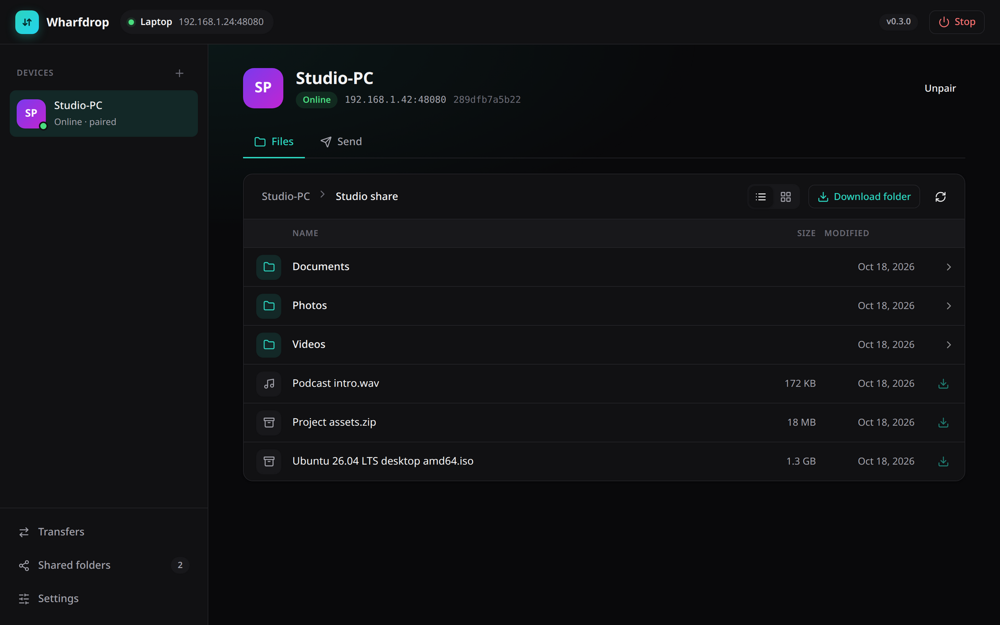

<p align="center">
  
</p>

<p align="center">
  <a href="https://github.com/Kumarsujay03/wharfdrop/actions/workflows/ci.yml"></a>
  <a href="https://github.com/Kumarsujay03/wharfdrop/releases/latest"></a>
  <a href="LICENSE"></a>
  
</p>

# Wharfdrop

**Secure, fast file sharing between your own computers on the same Wi-Fi or network.**
One small program for Linux, Windows and macOS. No accounts, no cloud, no internet needed.

Install it on two computers, pair them once with a 6-digit code, and then send files, share
folders, and browse and preview each other's shared files from a clean web interface or the
terminal.

## Features

* **Finds your devices automatically** on the local network. It doesn't matter whether one is
  on 2.4 GHz and the other on 5 or 6 GHz, as long as both use the same router.
* **Pair once, like Bluetooth.** Both screens show the same 6-digit code and you confirm on both.
* **Encrypted end to end** with TLS 1.3 and pinned device keys. Unpaired devices are refused.
* **Send files and folders** by drag and drop, with live progress.
* **Share folders read-only** with one paired device or all of them.
* **Browse with previews.** Switch between grid and list view, see photo thumbnails, and open
  photos, videos, audio, PDFs and text files in a built-in viewer. Download single files or
  whole folders as a zip.
* **Runs only when you want it.** Start it, use it, stop it. It never starts at login.
* **Keeps itself up to date** with signed updates from this repository's releases.
* **Web UI and CLI.** Everything in the interface can also be done from the terminal.

## Screenshots

<table>
  <tr>
    <td width="50%"><br><sub><b>Browse</b> a shared folder in grid view with thumbnails</sub></td>
    <td width="50%"><br><sub><b>Preview</b> photos, videos, audio, PDFs and text</sub></td>
  </tr>
  <tr>
    <td><br><sub><b>Send</b> files and folders by drag and drop</sub></td>
    <td><br><sub><b>Pair</b> by confirming the same 6-digit code on both devices</sub></td>
  </tr>
  <tr>
    <td><br><sub><b>List view</b> with sizes and dates</sub></td>
    <td><br><sub><b>Share folders</b> read-only, with light and dark themes</sub></td>
  </tr>
</table>

## Install

### Windows

Open **PowerShell** (no admin needed) and run:

```powershell
irm https://raw.githubusercontent.com/Kumarsujay03/wharfdrop/main/install.ps1 | iex
```

This downloads the latest release, checks its checksum, installs it to
`%LOCALAPPDATA%\Programs\Wharfdrop`, adds it to your `PATH`, adds **Wharfdrop** to the
Start menu, and opens it. It does not start Wharfdrop at login.

When Windows Firewall asks, allow Wharfdrop on **Private networks**. Otherwise other
devices cannot find this PC.

Prefer doing it by hand? Download `wharfdrop-<version>-windows-amd64.exe` from the
[latest release](https://github.com/Kumarsujay03/wharfdrop/releases/latest), rename it to
`wharfdrop.exe`, put it in a folder you own, and **double-click it**. It starts in the
background and opens the web UI in your browser. If SmartScreen warns about an unrecognised
app, click **More info** and then **Run anyway**.

To uninstall:

```powershell
$env:WHARFDROP_UNINSTALL=1; irm https://raw.githubusercontent.com/Kumarsujay03/wharfdrop/main/install.ps1 | iex
```

### Linux and macOS

```bash
curl -fsSL https://raw.githubusercontent.com/Kumarsujay03/wharfdrop/main/install.sh | sh
```

This installs the latest release to `~/.local/bin/wharfdrop` after checking its checksum.
On Ubuntu with ufw, open the ports once (see [Firewall](#firewall)).

All release files, including Linux/macOS/Windows on ARM, are on the
[releases page](https://github.com/Kumarsujay03/wharfdrop/releases/latest) with a
`SHA256SUMS` file.

### Build from source

You need [Go 1.22 or newer](https://go.dev/dl/) and Git. There are no other dependencies.

Windows (PowerShell, no `make` needed):

```powershell
git clone https://github.com/Kumarsujay03/wharfdrop.git
cd wharfdrop
powershell -ExecutionPolicy Bypass -File build.ps1     # runs the tests, builds bin\wharfdrop.exe
.\bin\wharfdrop.exe ui
```

Or with plain Go on any system: `go build -o wharfdrop.exe ./cmd/wharfdrop`.

Linux and macOS:

```bash
git clone https://github.com/Kumarsujay03/wharfdrop.git
cd wharfdrop
make test build        # bin/wharfdrop for this machine
./build.sh             # release binaries for every platform into dist/
```

Builds from source are development builds and do not update themselves.

## Use

Wharfdrop runs **only when you start it**. It never starts at login, and once stopped it
uses no CPU, memory or network.

On each device, when you want to share:

```bash
wharfdrop ui           # starts Wharfdrop in the background and opens the web UI
wharfdrop start        # ...or just start it in the background
wharfdrop stop         # stop everything when you are done
```

You can also click **Stop** in the web UI header. `wharfdrop stop` refuses while a transfer is
running; add `--force` to stop anyway. To run in a terminal window instead, use
`wharfdrop serve` and press Ctrl+C to stop. The background node logs to `wharfdrop.log` in
the config folder.

Pair (either from the web UI or the terminal):

```bash
wharfdrop status                 # lists devices seen on the LAN
wharfdrop pair my-windows-pc     # or: wharfdrop pair 192.168.1.20:48080
# other device:  wharfdrop allow   (or click Allow in its web UI)
```

Both screens show the same 6-digit code. Confirm only if they match.

Transfer:

```bash
wharfdrop send my-windows-pc ~/Videos/movie.mkv ~/Pictures/   # files or folders -> their incoming folder
wharfdrop share add videos "D:\Videos"                        # share a folder with all paired devices
wharfdrop share add work  ~/work --to my-windows-pc           # ...or with just one
wharfdrop shares my-windows-pc                                # what they share with me
wharfdrop ls  my-windows-pc videos/2025
wharfdrop get my-windows-pc videos/2025/clip.mp4 -o ~/Downloads
wharfdrop get my-windows-pc videos/2025 -o ~/Downloads        # folder -> 2025.zip
wharfdrop set incoming ~/Downloads/Wharfdrop
```

Incoming files land in `~/Wharfdrop` by default. Config, keys and the UI token are in
`~/.config/wharfdrop` (Linux) or `%AppData%\wharfdrop` (Windows). Set `WHARFDROP_DIR`
to use another directory (handy for running two nodes on one machine while testing).

## Updates

Wharfdrop keeps itself up to date from this repository's
[releases](https://github.com/Kumarsujay03/wharfdrop/releases).

* While Wharfdrop is running it checks one minute after you start it, then every 6 hours.
  Nothing checks while it is stopped.
* By default a new version is **installed automatically**, then Wharfdrop restarts itself.
  It waits if a transfer is in progress.
* Change this in the web UI header, or from the terminal:

```bash
wharfdrop set auto-update auto      # default: install updates automatically
wharfdrop set auto-update notify    # only tell me (web UI banner, `wharfdrop status`)
wharfdrop set auto-update off       # never check
wharfdrop update --check            # check now
wharfdrop update                    # install now
wharfdrop version
```

**How updates stay safe.** Every release's `SHA256SUMS` is signed in CI with an Ed25519
key, and the matching public key is compiled into Wharfdrop. An update is installed only if
the signature verifies *and* the downloaded binary matches its signed checksum. A tampered
file or a release signed with any other key is refused, and the current binary is left
untouched. Builds from source (`make build`) are development builds and never update
themselves.

Version v0.1.0 has no updater. Download v0.2.0 or newer once by hand; after that it updates
itself.

## Firewall

The daemon needs two inbound ports open on the LAN:

| Port | Protocol | Purpose |
|---|---|---|
| 47070 | UDP | discovery beacons (multicast 239.255.70.70) |
| 48080 | TCP | peer API (TLS) |

Ubuntu with ufw:

```bash
sudo ufw allow 47070/udp && sudo ufw allow 48080/tcp
```

Windows: accept the Defender Firewall prompt on first run for *private* networks, or
run `wharfdrop start` once and allow it when Windows asks.

If devices do not list each other, discovery is being filtered (ufw, router "AP/client
isolation", some mesh systems). Pairing by IP address still works, and once paired the
devices remember each other's last address.

## Security model

* Each device generates an Ed25519 key and a self-signed certificate on first run. Its
  SHA-256 fingerprint is the device identity.
* Pairing runs over TLS with both sides presenting their certificate. Each side derives
  the code from the two fingerprints *it actually saw in the handshake*. A man-in-the-middle
  would present a different certificate to each side, so the two screens would show
  different codes and the user would refuse. The initiating side additionally aborts if the
  code it computes differs from the one the other side reports.
* After pairing, every connection is TLS 1.3 with the peer's fingerprint pinned on both ends.
  There is no CA and no trust-on-first-use.
* Shares are read-only and jailed to their folder (paths are normalised and checked against
  the root). Only peers listed on a share can see it.
* Incoming files are written to a `.part` file and renamed when complete; existing names get
  ` (1)`, ` (2)` suffixes rather than being overwritten.
* The loopback API needs a random per-install token, so other local processes or web pages
  cannot drive the daemon.
* Previews are sandboxed. HTML, SVG, scripts and other active content are always shown as
  plain text, so a file shared by another device can never run code in your Wharfdrop page.

## Speed

Transfers are plain TLS streams over HTTP/1.1 with 1 MiB buffers and 4 MiB socket buffers;
Go's AES-GCM uses hardware acceleration, so the Wi-Fi link is the bottleneck, not the
software (loopback runs at >1 GB/s). On Wi-Fi, two clients on the same access point talk
*through* the AP, so expect roughly half of the slower device's link rate. A device on
2.4 GHz caps the pair at a few MB/s to ~10 MB/s; two 5 GHz Wi-Fi 6 devices reach
30-80 MB/s. Plugging either machine into the router by Ethernet helps a lot.

## FAQ

**Does it work on phones?**
Not yet. Wharfdrop runs on Linux, Windows and macOS computers. Its web interface only opens
on the computer that runs it, so a phone cannot use it today. Phone support is on the roadmap.

**Is anything sent over the internet?**
No. Devices talk directly over your local network. The only internet access is the optional
update check against this repository's releases, which you can turn off in Settings.

**Why can't my devices see each other?**
Usually a firewall blocks UDP port 47070, or the router keeps Wi-Fi clients apart
("AP isolation"). See [Firewall](#firewall), or pair by IP address with the **+** button.

## Contributing

Bug reports, ideas and pull requests are welcome. See [CONTRIBUTING.md](CONTRIBUTING.md),
and report security issues privately as described in [SECURITY.md](SECURITY.md).

## Layout

```
cmd/wharfdrop/        CLI (thin client of the daemon's loopback API)
internal/identity     keys, certificate, fingerprints, pairing code
internal/config       config.json: name, ports, trusted peers, shares
internal/discovery    multicast beacons
internal/daemon       peer API (mTLS), pairing, transfers, loopback API, web UI (ui.html)
internal/update       signed self-updater
tools/release-sign    signs release checksums in CI
```

## License

[MIT](LICENSE) © 2026 Sujay Kumar
