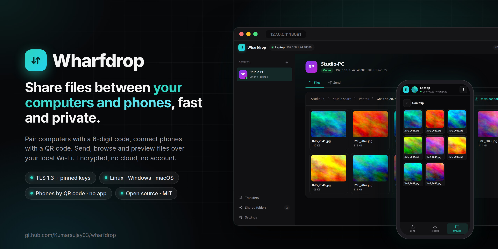
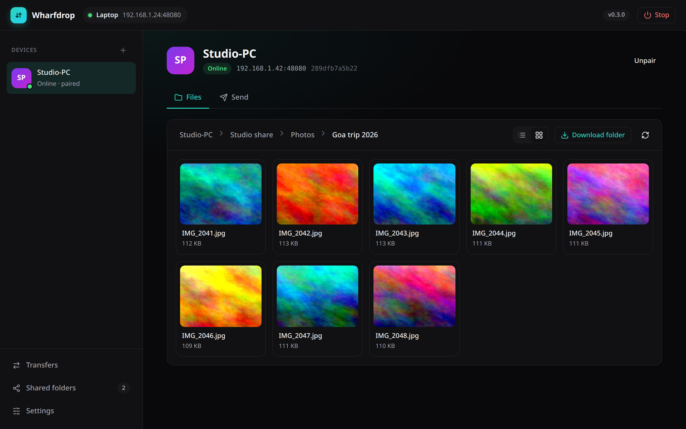
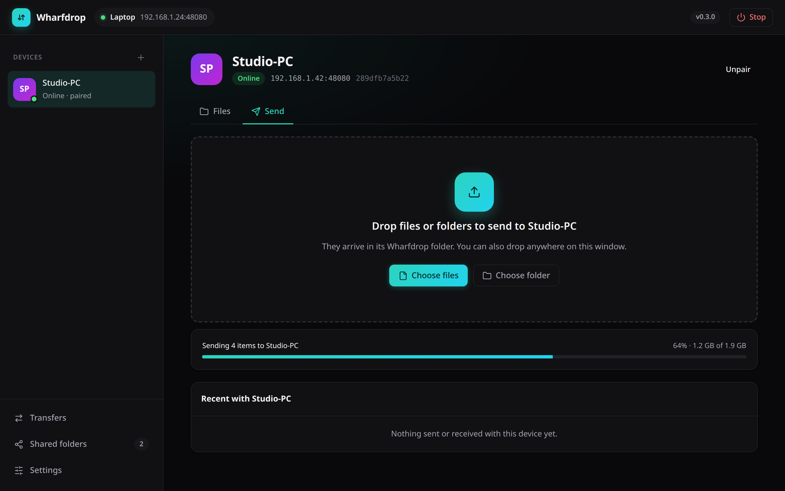
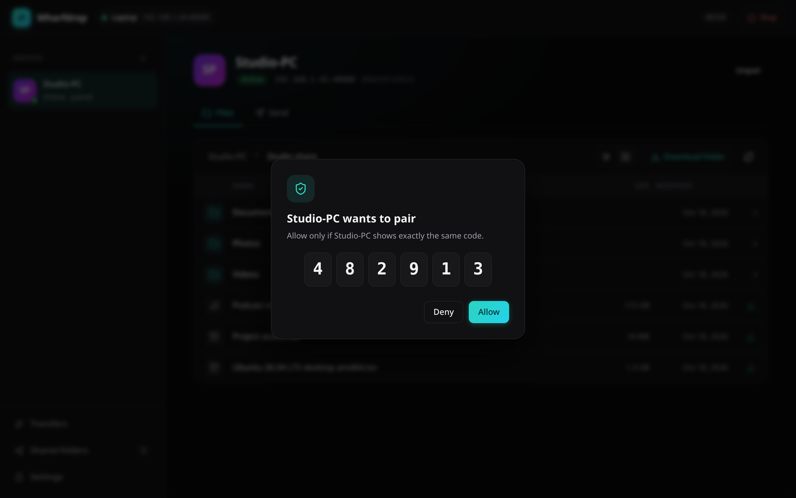
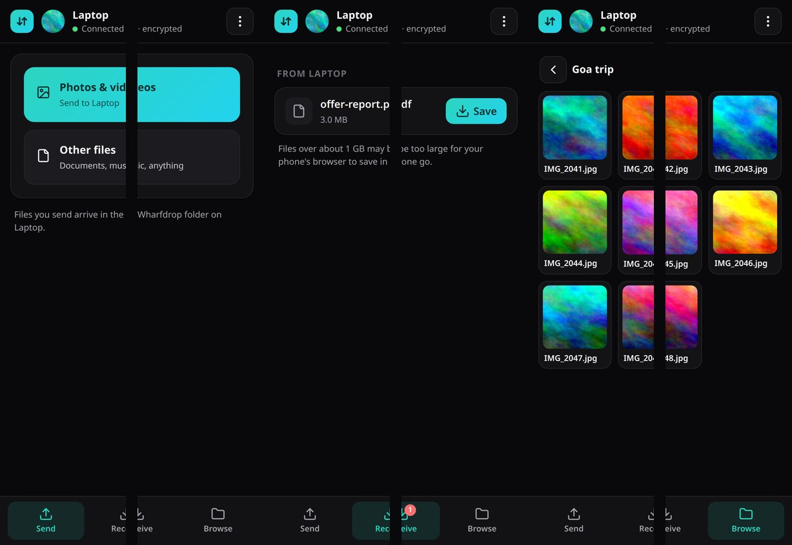
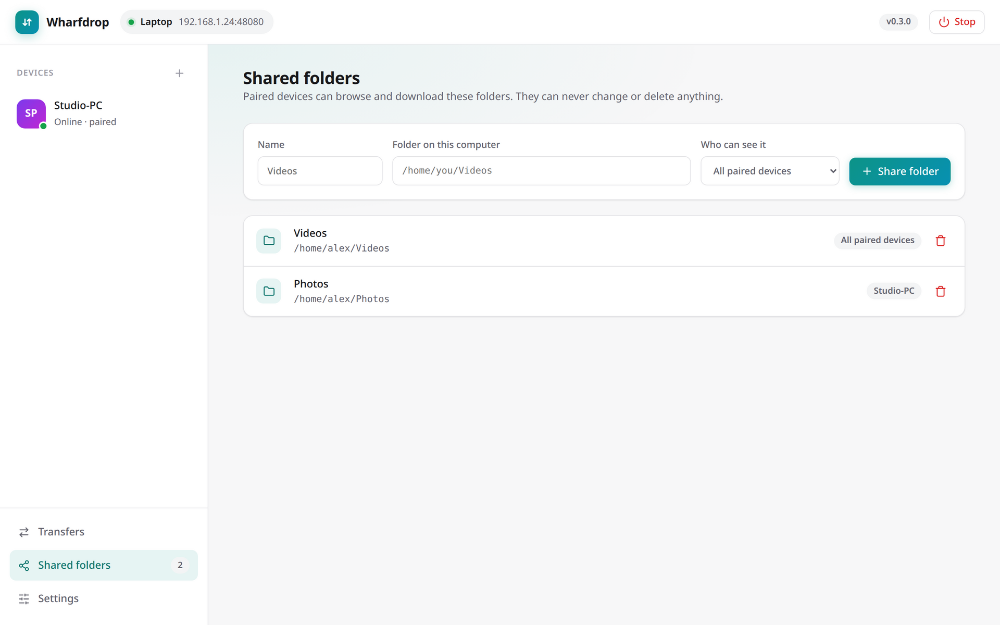

<p align="center">
  
</p>

<p align="center">
  <a href="https://github.com/Kumarsujay03/wharfdrop/actions/workflows/ci.yml"></a>
  <a href="https://github.com/Kumarsujay03/wharfdrop/releases/latest"></a>
  <a href="LICENSE"></a>
  
  
</p>

# Wharfdrop

**Secure, fast file sharing between your own computers and phones on the same Wi-Fi.**
One small program for Linux, Windows and macOS. Phones join through their browser by scanning a
QR code. No accounts, no cloud, no internet needed.

<p align="center">
  <a href="#install"><b>Install</b></a> ·
  <a href="#quick-start"><b>Quick start</b></a> ·
  <a href="#phones"><b>Phones</b></a> ·
  <a href="#security-model"><b>Security</b></a> ·
  <a href="#speed"><b>Speed</b></a> ·
  <a href="#faq"><b>FAQ</b></a>
</p>

## Quick start

1. **Install** Wharfdrop on each computer ([Windows](#windows), [Linux and macOS](#linux-and-macos)).
2. **Open it** with `wharfdrop ui` (or double-click it on Windows). Computers on the same network
   find each other. Click **Pair** and confirm the same 6-digit code on both screens.
3. **Share.** Drag files onto a device to send them, share folders for others to browse, and click
   **Connect a phone** to add a phone with a QR code.

## Features

**Computers**

* **Finds your devices automatically** on the local network. It doesn't matter whether one is
  on 2.4 GHz and the other on 5 or 6 GHz, as long as both use the same router.
* **Pair once, like Bluetooth.** Both screens show the same 6-digit code and you confirm on both.
* **Encrypted end to end** with TLS 1.3 and pinned device keys. Unpaired devices are refused.
* **Send files and folders** by drag and drop, with live speed and time left on both devices.
  Large files travel over four parallel connections, which copes better with Wi-Fi interference.
* **Share folders read-only** with one paired device or all of them.
* **Browse with previews.** Switch between grid and list view, see photo thumbnails, and open
  photos, videos, audio, PDFs and text files in a built-in viewer. Download single files or
  whole folders as a zip.

**Phones**

* **No app to install.** Scan a QR code and the phone's browser connects.
* **Send** photos, videos and files to the computer, **receive** files it sends, and **browse**
  its shared folders with thumbnails, all with live speed.
* **Encrypted inside the page** with a key that only travels in the QR code.
* **Remember this phone** to reconnect without scanning again.

**Everyday use**

* **Runs only when you want it.** Start it, use it, stop it. It never starts at login, and the
  phone link closes after 10 minutes without activity.
* **Keeps itself up to date** with signed updates from this repository's releases.
* **Profile pictures** so your devices are easy to tell apart.
* **Web UI and CLI.** Everything in the interface can also be done from the terminal.
* **Clean uninstall** that keeps your received files.

## Screenshots

<table>
  <tr>
    <td width="50%"><br><sub><b>Browse</b> a shared folder in grid view with thumbnails</sub></td>
    <td width="50%"><br><sub><b>Preview</b> photos, videos, audio, PDFs and text</sub></td>
  </tr>
  <tr>
    <td><br><sub><b>Send</b> files and folders by drag and drop</sub></td>
    <td><br><sub><b>Pair</b> by confirming the same 6-digit code on both devices</sub></td>
  </tr>
  <tr>
    <td><br><sub><b>Phones</b> connect by QR code: send, receive and browse in the browser</sub></td>
    <td><br><sub><b>Share folders</b> read-only, with light and dark themes</sub></td>
  </tr>
</table>

## Install

### Windows

Open **PowerShell** (no admin needed) and run:

```powershell
irm https://raw.githubusercontent.com/Kumarsujay03/wharfdrop/main/install.ps1 | iex
```

This downloads the latest release, checks its checksum, installs it to
`%LOCALAPPDATA%\Programs\Wharfdrop`, adds it to your `PATH`, adds **Wharfdrop** to the
Start menu, and opens it. It does not start Wharfdrop at login.

When Windows Firewall asks, allow Wharfdrop on **Private networks**. Otherwise other
devices cannot find this PC.

Prefer doing it by hand? Download `wharfdrop-<version>-windows-amd64.exe` from the
[latest release](https://github.com/Kumarsujay03/wharfdrop/releases/latest), rename it to
`wharfdrop.exe`, put it in a folder you own, and **double-click it**. It starts in the
background and opens the web UI in your browser. If SmartScreen warns about an unrecognised
app, click **More info** and then **Run anyway**.

To uninstall, see [Uninstall](#uninstall).

### Linux and macOS

```bash
curl -fsSL https://raw.githubusercontent.com/Kumarsujay03/wharfdrop/main/install.sh | sh
```

This installs the latest release to `~/.local/bin/wharfdrop` after checking its checksum.
On Ubuntu with ufw, open the ports once (see [Firewall](#firewall)).

All release files, including Linux/macOS/Windows on ARM, are on the
[releases page](https://github.com/Kumarsujay03/wharfdrop/releases/latest) with a
`SHA256SUMS` file.

### Build from source

You need [Go 1.26 or newer](https://go.dev/dl/) and Git. Go fetches the two small dependencies
(`golang.org/x/crypto` and `rsc.io/qr`) automatically.

Windows (PowerShell, no `make` needed):

```powershell
git clone https://github.com/Kumarsujay03/wharfdrop.git
cd wharfdrop
powershell -ExecutionPolicy Bypass -File build.ps1     # runs the tests, builds bin\wharfdrop.exe
.\bin\wharfdrop.exe ui
```

Or with plain Go on any system: `go build -o wharfdrop.exe ./cmd/wharfdrop`.

Linux and macOS:

```bash
git clone https://github.com/Kumarsujay03/wharfdrop.git
cd wharfdrop
make test build        # bin/wharfdrop for this machine
./build.sh             # release binaries for every platform into dist/
```

Builds from source are development builds and do not update themselves.

## Use

Wharfdrop runs **only when you start it**. It never starts at login, and once stopped it
uses no CPU, memory or network.

On each device, when you want to share:

```bash
wharfdrop ui           # starts Wharfdrop in the background and opens the web UI
wharfdrop start        # ...or just start it in the background
wharfdrop stop         # stop everything when you are done
```

You can also click **Stop** in the web UI header, or just close the Wharfdrop window: when
its last window closes, Wharfdrop stops about 10 seconds later (reloading the page does not
count, and running transfers finish first). Turn this off in **Settings → When this window is
closed**. Stopping is clean: connected phones are told and show "Phone link closed", paired
computers see this one go offline at once, and every port is closed before the program exits.
`wharfdrop stop` refuses while a transfer is running; add `--force` to stop anyway. To run in a terminal window instead, use
`wharfdrop serve` and press Ctrl+C to stop. The background node logs to `wharfdrop.log` in
the config folder.

Pair (either from the web UI or the terminal):

```bash
wharfdrop status                 # lists devices seen on the LAN
wharfdrop pair my-windows-pc     # or: wharfdrop pair 192.168.1.20:48080
# other device:  wharfdrop allow   (or click Allow in its web UI)
```

Both screens show the same 6-digit code. Confirm only if they match.

Transfer:

```bash
wharfdrop send my-windows-pc ~/Videos/movie.mkv ~/Pictures/   # files or folders -> their incoming folder
wharfdrop share add videos "D:\Videos"                        # share a folder with all paired devices
wharfdrop share add work  ~/work --to my-windows-pc           # ...or with just one
wharfdrop shares my-windows-pc                                # what they share with me
wharfdrop ls  my-windows-pc videos/2025
wharfdrop get my-windows-pc videos/2025/clip.mp4 -o ~/Downloads
wharfdrop get my-windows-pc videos/2025 -o ~/Downloads        # folder -> 2025.zip
wharfdrop set incoming ~/Downloads/Wharfdrop
```

Incoming files land in `~/Wharfdrop` by default. Config, keys and the UI token are in
`~/.config/wharfdrop` (Linux) or `%AppData%\wharfdrop` (Windows). Set `WHARFDROP_DIR`
to use another directory (handy for running two nodes on one machine while testing).

## Phones

Phones connect through their web browser, so there is nothing to install on the phone.

1. On the computer, click **Connect a phone** in the sidebar (or run `wharfdrop phone`).
2. Scan the QR code with the phone's camera. The phone must be on the same Wi-Fi.
3. The phone opens Wharfdrop in its browser:
   * **Send** photos, videos and files to the computer. They land in the received-files folder.
   * **Receive** files the computer sends. Select the phone on the computer, drop files, then tap
     **Save** on the phone.
   * **Browse** folders the computer shares with all paired devices, with photo thumbnails.

Tick **Remember this phone** in the phone's menu to reconnect later without scanning, while the
phone link is open. The phone link closes after 10 minutes without activity, when you click
the close button, or when Wharfdrop stops; the phone page then says why within about two
seconds.

**Disconnecting** works from either side. **Disconnect** in the phone's menu deletes the key
on the phone and revokes it on the computer, so the phone disappears from the computer at once.
Removing a phone on the computer shows "Disconnected" on the phone. Closing the phone's browser
tab shows it as offline straight away.

From the terminal:

```bash
wharfdrop phone                     # open the phone link and show the QR code
wharfdrop phone list                # phones and whether they are connected
wharfdrop send "Sujay's iPhone" holiday.mp4
wharfdrop phone stop
```

**How phones stay secure.** Phone browsers block their built-in encryption on local `http://`
pages, and a self-signed HTTPS certificate only teaches people to click through warnings. So the
QR code carries a random 256-bit key in the part of the link browsers never send, and every
request, response and file chunk is encrypted with XChaCha20-Poly1305 inside the page. A device
on the same Wi-Fi without the QR code can neither read nor fake anything. See
[SECURITY.md](SECURITY.md) for the remaining limit.

**Limits.** Saving very large files on the phone (over about 1 GB) may fail, because the phone's
browser holds them in memory while decrypting. Sending from the phone has no such limit. Only
single files can be sent to phones, not folders.

## Updates

Wharfdrop keeps itself up to date from this repository's
[releases](https://github.com/Kumarsujay03/wharfdrop/releases).

* While Wharfdrop is running it checks one minute after you start it, then every 6 hours.
  Nothing checks while it is stopped.
* By default a new version is **installed automatically**, then Wharfdrop restarts itself.
  It waits if a transfer is in progress.
* Change this in the web UI header, or from the terminal:

```bash
wharfdrop set auto-update auto      # default: install updates automatically
wharfdrop set auto-update notify    # only tell me (web UI banner, `wharfdrop status`)
wharfdrop set auto-update off       # never check
wharfdrop update --check            # check now
wharfdrop update                    # install now
wharfdrop version
```

**How updates stay safe.** Every release's `SHA256SUMS` is signed in CI with an Ed25519
key, and the matching public key is compiled into Wharfdrop. An update is installed only if
the signature verifies *and* the downloaded binary matches its signed checksum. A tampered
file or a release signed with any other key is refused, and the current binary is left
untouched. Builds from source (`make build`) are development builds and never update
themselves.

Version v0.1.0 has no updater. Download v0.2.0 or newer once by hand; after that it updates
itself.

## Firewall

Wharfdrop needs these inbound ports open on the local network:

| Port | Protocol | Purpose |
|---|---|---|
| 47070 | UDP | discovery beacons (multicast 239.255.70.70) |
| 48080 | TCP | peer API (TLS) |
| 48082 | TCP | phone link, only while it is open |

Ubuntu with ufw:

```bash
sudo ufw allow 47070/udp && sudo ufw allow 48080/tcp && sudo ufw allow 48082/tcp
```

If a phone stays on a blank, loading page, the firewall is blocking port 48082. The QR dialog
shows the exact command for your system.

Windows: accept the Defender Firewall prompt on first run for *private* networks, or
run `wharfdrop start` once and allow it when Windows asks.

If devices do not list each other, discovery is being filtered (ufw, router "AP/client
isolation", some mesh systems). Pairing by IP address still works, and once paired the
devices remember each other's last address.

## Security model

* Each device generates an Ed25519 key and a self-signed certificate on first run. Its
  SHA-256 fingerprint is the device identity.
* Pairing runs over TLS with both sides presenting their certificate. Each side derives
  the code from the two fingerprints *it actually saw in the handshake*. A man-in-the-middle
  would present a different certificate to each side, so the two screens would show
  different codes and the user would refuse. The initiating side additionally aborts if the
  code it computes differs from the one the other side reports.
* After pairing, every connection is TLS 1.3 with the peer's fingerprint pinned on both ends.
  There is no CA and no trust-on-first-use.
* Shares are read-only and jailed to their folder (paths are normalised and checked against
  the root). Only peers listed on a share can see it.
* Incoming files are written to a `.part` file and renamed when complete; existing names get
  ` (1)`, ` (2)` suffixes rather than being overwritten.
* The loopback API needs a random per-install token, so other local processes or web pages
  cannot drive the daemon.
* Previews are sandboxed. HTML, SVG, scripts and other active content are always shown as
  plain text, so a file shared by another device can never run code in your Wharfdrop page.
* Phones use a separate, on-demand link. Everything is encrypted inside the page with
  XChaCha20-Poly1305 and a 256-bit key carried only in the QR code; requests are replay-checked
  and download links work once. See [Phones](#phones) and [SECURITY.md](SECURITY.md).

## Speed

Wharfdrop is rarely the bottleneck: it moves well over 1 GB/s between two processes on one
machine. Over Wi-Fi the radio link decides.

* Files of 24 MB or more are sent as 8 MB chunks over **four parallel TLS connections**, reusing
  connections between requests. Several connections recover from Wi-Fi packet loss better
  than one. Smaller files use a single stream.
* Two devices on the same access point talk *through* it, so expect roughly half of the
  slower device's link rate. A device on **2.4 GHz** usually caps the pair at 5-15 MB/s.
  Two **5 GHz / Wi-Fi 6** devices typically reach 30-80 MB/s.
* The biggest improvement is hardware: move the slower device to 5 GHz or plug either one
  into the router with Ethernet.

Measured on a simulated link (Linux `netem`), 500 MB file, v0.3.0 vs v0.4.0:

| Simulated link | v0.3.0 | v0.4.0 |
|---|---|---|
| 5 GHz-like, 400 Mbit/s, 0.3% loss | 48.4 MB/s | 48.2 MB/s |
| 2.4 GHz-like, 120 Mbit/s, 1% loss | 13.5 MB/s | 14.6 MB/s |
| Busy 2.4 GHz, 120 Mbit/s, 2% loss | 12.5 MB/s | 14.5 MB/s |

Real Wi-Fi varies more than a simulation, so treat these as a guide.

## Uninstall

```bash
wharfdrop uninstall
```

This stops Wharfdrop and removes the program, its settings, device keys and logs. On Windows
it also removes the Start menu shortcut and the PATH entry. **Your received files are kept**
(by default in the `Wharfdrop` folder in your home folder). Add `--yes` to skip the question.
Paired devices will need to pair again if you reinstall.

The Windows installer can also uninstall:

```powershell
$env:WHARFDROP_UNINSTALL=1; irm https://raw.githubusercontent.com/Kumarsujay03/wharfdrop/main/install.ps1 | iex
```

## FAQ

**Does it work on phones?**
Yes, through the phone's browser. See [Phones](#phones). Wharfdrop itself runs on Linux,
Windows and macOS computers; the phone connects to one of them.

**Does installing put the source code on my computer?**
No. The installers and the release downloads contain only the single `wharfdrop` program file.
You only get the source code if you choose to clone this repository to build it yourself.

**Is it less secure because the code is public?**
No. Wharfdrop's security comes from keys, not secrecy. Each device's private key is created on
that device and never leaves it, connections are encrypted with TLS 1.3, and updates must carry
a signature from a release key that is not in this repository. Public code lets anyone check
how this works.

**Is anything sent over the internet?**
No. Devices talk directly over your local network. The only internet access is the optional
update check against this repository's releases, which you can turn off in Settings.

**Why can't my devices see each other?**
Usually a firewall blocks UDP port 47070, or the router keeps Wi-Fi clients apart
("AP isolation"). See [Firewall](#firewall), or pair by IP address with the **+** button.

## Contributing

Bug reports, ideas and pull requests are welcome. See [CONTRIBUTING.md](CONTRIBUTING.md),
and report security issues privately as described in [SECURITY.md](SECURITY.md).

## Layout

```
cmd/wharfdrop/        CLI (thin client of the daemon's loopback API)
internal/identity     keys, certificate, fingerprints, pairing code
internal/config       config.json: name, ports, trusted peers, shares
internal/discovery    multicast beacons
internal/daemon       peer API (mTLS), pairing, transfers, loopback API, web UI (ui.html)
internal/daemon/phone phone page (HTML/JS) and vendored noble-ciphers
internal/update       signed self-updater
tools/release-sign    signs release checksums in CI
```

## License

[MIT](LICENSE) © 2026 Sujay Kumar
